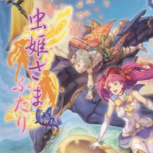

<div align=center>



</div>
<h1 align=center>futari-nx installer</h1>

The installer page of [futari-nx](https://github.com/ChanseyIsTheBest/futari-nx), the native Nintendo Switch port of
Mushihimesama Futari Ver 1.5 (Xbox 360): **https://chanseyisthebest.github.io/futari-nx-installer/**

You give it your own copy of the game (the disc image, or a folder you extracted it into), with the Black Label and
Ver 1.01 DLC if you have them, and it gives you a zip ready to extract into `sdmc:/switch/`. Everything runs in your
browser: the game files never leave your computer.

## What it does

1. Finds the game in what you chose: a disc image (`.iso`: a full dump, read in place through its XDVDFS game
   partition, or an image rebuilt by extract-xiso; nothing is extracted to disk), or a folder with `default.xex`.
   The DLC packages of the game (content type 2 of title `435A07D7`: Black Label and the Ver 1.01 unlock) are picked
   up too, as package files or as unpacked folders, wherever they are among the chosen files.
2. Identifies the game by the SHA-256 of `default.xex` and picks its build from `release/manifest.json`.
3. Downloads that build's NRO and checks its SHA-256.
4. Makes the shaders of the deko3d renderer (futari-nx 1.0.1 on: the NRO holds no shader of the game and reads
   `deko3d_glsl.bin` beside itself), the way peggle2-nx-installer does it. Futari keeps all its shaders inside
   `default.xex` and the eight game cores of `media/Module`, as Direct3D shader containers in their data: 42 distinct
   ones. Each goes through futari-nx's native chain (`tools/renut_deko3d_shaders.sh`), in the page: Renut's
   XenosRecomp translates it to HLSL (`wasm/renut_hlsl`), the alpha-tested pixel shaders get their early alpha copy
   (`lib/early_alpha.js`, futari-nx's `tools/renut_early_alpha.py`), DXC compiles it to SPIR-V (`wasm/dxc_web`),
   SPIRV-Cross turns that into GLSL (`wasm/spirv_cross`), banjo-nx's passes trim it (`lib/deko3d_glsl.js`) and
   `lib/deko3d_package.js` packs them. 40 of the 42 shaders' GLSL is the native chain's byte for byte (the other
   two differ only where the page's newer DXC numbers its values or writes one vector differently), and the package
   must match the tested one (its SHA-256 is in `release/manifest.json`). The console compiles each shader with uam the
   first time the game uses it and keeps the result. (A build with `futari_shaders.mesp`, 1.0.0's renderer, has the
   shader library made instead: `lib/shaders.js`.)
5. Streams the zip to disk through the service worker, so a whole disc never has to fit in memory.

The zip holds `futari-nx/futari.nro` with its `LICENSES.txt`, `deko3d_glsl.bin`, the game in `game_root/` (as on the
disc, without the console's system update) and, if you chose it, the DLC in `dlc/` (the game installs it at its first
start). The update zip holds the NRO, its licenses and the shaders (and the DLC if you chose it). Neither holds
`futari.toml`: the game writes it at its first start, so an update never overwrites your settings.

The page and the downloaded program are cached by the service worker: after the first visit it also works without a
connection.

## Layout

| Path | Contents |
|---|---|
| `index.html`, `app.js` | The page and its interface (English and Japanese, `lib/i18n.js`) |
| `worker.js` | Builds the package off the main thread |
| `sw.js` | Offline cache and the download stream |
| `lib/` | Disc image reader (XDVDFS), STFS header reader, XEX reader, shader extraction and library, the deko3d shaders (`deko3d.js`, `early_alpha.js`, `deko3d_glsl.js`, `deko3d_package.js`), zip writer |
| `wasm/` | WebAssembly builds of the shader translators (1.0.0's and Renut's), DXC, SPIRV-Cross, the library packer and the LZX decoder |
| `shader_common.h` | 1.0.0's translator's HLSL header (from `shaders/XenosRecomp` of futari-nx) |
| `renut_shader_common.h` | Renut's translator's HLSL header (from `app/thirdparty/reblue-XenosRecomp/XenosRecomp` of futari-nx) |
| `release/` | The list of builds and the licenses of the NRO |
| `test/` | Node scripts and a browser page that run the same code as the page |

`wasm/hlsl.*`, `wasm/pack.*` and `wasm/lzx.*` are built from the futari-nx repository with
`shaders/wasm/build_wasm_tools.sh` (Emscripten); `wasm/renut_hlsl.*` (Renut's translator with futari-nx's
`tools/renut_hlsl_frontend.cpp`, peggle2-nx's) and `wasm/spirv_cross.*` with `wasm/src/deko3d/build_wasm_deko3d.sh`
(the copies here are peggle2-nx-installer's builds of the same translator sources). `wasm/dxc_web.*` is the WebAssembly DXC of
[nfsmw-nx-installer](https://github.com/StevensND/nfsmw-nx-installer) (unmodified DXC v2025.1 with the
`dxc_web.cpp` wrapper that is also in `shaders/wasm/` of futari-nx); see [NOTICES.md](NOTICES.md).

## Deployment

The NRO is not stored here: it is the `futari.nro` asset of a release of the futari-nx repository of the same owner.
The workflow in `.github/workflows/deploy.yml` downloads it from the latest release, checks its SHA-256 against the
list and publishes the page on GitHub Pages. It runs on every push to `main`; after publishing a new release, run it
by hand from the Actions tab. Pages must be set to deploy from GitHub Actions (Settings > Pages > Source).

To publish a new build, update the build's entry in `release/manifest.json`. This script fills in the NRO's SHA-256
and size and the fingerprints of the game and of the shader library, made from your own copy with the page's code:

```sh
node test/release_node.mjs <disc image or game folder> <futari.nro> --version 1.0.1 --no-library --deko3d --write
```

`--deko3d` writes the build's `"deko3d"` entry (its shaders, their containers' SHA-256 and the package's) and leaves the
page's `deko3d_glsl.bin` in `release/` (not committed): test the NRO with exactly that file next to it.
`--no-library` is for a build without 1.0.0's shader library (`"shader_library": false`); without it the library is
made and left in `release/futari_shaders.mesp` (+ `.idx`).

## Testing locally

Put `futari.nro` in `release/` and serve the folder (any static server works; this one sets the right MIME types):

```sh
python serve.py 8193
```

Then open http://127.0.0.1:8193/. The same code runs in Node:

```sh
node test/package_node.mjs futari-nx.zip <disc image or game folder> [<DLC packages or folders> ...]
node test/package_node.mjs futari-nx-update.zip <disc image or game folder> --update
node test/library_node.mjs <disc image or game folder> [<reference futari_shaders.mesp>]
node test/deko3d_node.mjs <disc image or game folder> [<futari-nx's out/deko3d_shaders/glsl_opt>] [--out deko3d_glsl.bin]
node test/early_alpha_node.mjs <translator HLSL folder> <renut_early_alpha.py's output folder>
node test/texts_node.mjs
```

And in a browser: start `python serve.py 8193 . --test-files <folder that holds the disc image>`, then open
`http://127.0.0.1:8193/test/browser.html?image=<disc image file name>`. It reads the image through range requests,
makes the shader library, and makes an update package through `worker.js` and `sw.js` (nothing is saved to disk).

## License

GPL-3.0 (see [LICENSE](LICENSE)). Third-party components are listed in [NOTICES.md](NOTICES.md). The page is built on
[sa2-nx-installer](https://github.com/ChanseyIsTheBest/sa2-nx-installer), itself built on
[nfsmw-nx-installer](https://github.com/StevensND/nfsmw-nx-installer) by StevensND; its deko3d shaders follow
peggle2-nx-installer's.

Mushihimesama Futari is a trademark of CAVE Interactive; the icon artwork is © CAVE. This project is not affiliated
with or endorsed by CAVE, Nintendo or Microsoft.
